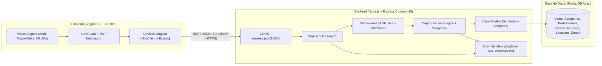

# Arquitectura del Sistema — S.O.S. Geo

---

## 1. Arquitectura General

S.O.S. Geo implementa una arquitectura cliente-servidor desacoplada en un monorepositorio con dos aplicaciones independientes (`frontend/` en Angular y `backend/` en Node.js + Express) conectadas a una base de datos en la nube (**MongoDB Atlas**).



### Flujo de Petición en el Backend (Convención del Semestre)
1. **`src/app.js`**: Configura `cors()` leyendo `FRONTEND_ORIGINS`, limita el body JSON con `express.json({ limit: "100kb" })`, registra tiempos de respuesta en consola y monta `routerApi(app)` bajo el prefijo `/api`.
2. **`src/routes/*.router.js`**: Recibe la petición HTTP, aplica el middleware `requireAuth` (cuando la ruta es protegida) y el middleware validador de payload o query (`validate*Payload`, `validate*Query`), e invoca al servicio correspondiente dentro de un bloque `try / catch (error) { next(error); }`.
3. **`src/services/*.service.js`**: Contiene una clase por entidad (`AuthService`, `CategoriesService`, `ProfessionalsService`, `ServiceRequestsService`, `LocationsService`, `ZonesService`). Ejecuta toda la lógica de negocio, validaciones de integridad referencial y consultas a MongoDB mediante Mongoose (`.populate()`), lanzando instancias de `AppError` en caso de error.
4. **`src/models/*.model.js`**: Define los esquemas de Mongoose con `timestamps: true`, transformación `toJSON` (convirtiendo `_id` a `id` y ocultando `__v` y `password`) e índices geoespaciales `2dsphere`.
5. **`src/middlewares/error.handler.js`**: Intercepta rutas no existentes (`notFoundHandler` → 404), imprime la traza en consola (`logErrors`) y devuelve una estructura JSON estandarizada (`errorHandler`).

---

## 2. Estructura de Carpetas del Monorepositorio

```text
S.O.S.-Geo/
├── .gitignore
├── README.md
├── docs/
│   ├── PROJECT_PLAN.md
│   ├── ARCHITECTURE.md
│   ├── DATABASE.md
│   ├── API_CONTRACTS.md
│   ├── BACKLOG.md
│   └── RUBRIC_CHECKLIST.md
├── backend/
│   ├── .env.example
│   ├── package.json
│   ├── request/
│   │   ├── auth.http
│   │   ├── categories.http
│   │   ├── professionals.http
│   │   ├── service-requests.http
│   │   ├── locations.http
│   │   └── zones.http
│   └── src/
│       ├── index.js                      # Conexión a MongoDB + app.listen + cierre controlado (SIGINT/SIGTERM)
│       ├── app.js                        # CORS, express.json(100kb), logger, routerApi, errorHandlers
│       ├── config/
│       │   └── database.js               # connectDatabase() y disconnectDatabase() con Mongoose
│       ├── utils/
│       │   ├── appError.js               # Clase AppError(statusCode, message, details)
│       │   └── jwt.js                    # signToken() y verifyToken()
│       ├── middlewares/
│       │   ├── error.handler.js          # notFoundHandler, logErrors, errorHandler
│       │   ├── auth.handler.js           # requireAuth (valida Bearer JWT e inyecta req.user)
│       │   ├── auth.validator.js         # validateRegisterPayload, validateLoginPayload
│       │   ├── category.validator.js     # validateCategoryPayload
│       │   ├── professional.validator.js # validateProfessionalPayload
│       │   ├── service-request.validator.js # validateServiceRequestPayload
│       │   ├── location.validator.js     # validateLocationPayload, validateLocationQuery
│       │   └── zone.validator.js         # validateZonePayload (valida cierre de Polygon y rangos [lng,lat])
│       ├── models/
│       │   ├── user.model.js
│       │   ├── category.model.js
│       │   ├── professional.model.js
│       │   ├── service-request.model.js
│       │   ├── location.model.js         # GeoJSON Point + index({ location: "2dsphere" })
│       │   └── zone.model.js             # GeoJSON Polygon + index({ area: "2dsphere" })
│       ├── services/
│       │   ├── auth.service.js           # register, login, getProfile (bcrypt + JWT)
│       │   ├── categories.service.js     # CRUD + validación contra referencias huérfanas
│       │   ├── professionals.service.js  # CRUD + populate(category, zone)
│       │   ├── service-requests.service.js # CRUD + populate(category, location, professional, requestedBy)
│       │   ├── locations.service.js      # CRUD + filtros (?search=&category=&status=) + getGeoJSON
│       │   └── zones.service.js          # CRUD + cierre de anillo Polygon + getGeoJSON
│       ├── routes/
│       │   ├── index.js                  # routerApi(app) montando /api/*
│       │   ├── auth.router.js
│       │   ├── categories.router.js
│       │   ├── professionals.router.js
│       │   ├── service-requests.router.js
│       │   ├── locations.router.js
│       │   └── zones.router.js
│       └── data/
│           ├── seed.js                   # Limpia e inserta usuario demo, categorías, profesionales, zonas, ubicaciones y solicitudes
│           ├── users.seed.js
│           ├── categories.seed.js
│           ├── professionals.seed.js
│           ├── zones.seed.js
│           ├── locations.seed.js
│           └── service-requests.seed.js
└── frontend/
    ├── angular.json
    ├── package.json
    ├── tsconfig.json
    └── src/
        ├── index.html
        ├── main.ts
        ├── styles.css                    # Estilos globales + CSS de Leaflet y Leaflet-Geoman
        ├── environments/
        │   ├── environment.ts            # apiUrl: 'http://localhost:3000/api'
        │   └── environment.prod.ts       # apiUrl: 'https://<backend-render>.onrender.com/api'
        └── app/
            ├── app.component.ts
            ├── app.config.ts
            ├── app.routes.ts             # Definición de rutas con authGuard
            ├── core/
            │   ├── guards/
            │   │   └── auth.guard.ts
            │   ├── interceptors/
            │   │   └── auth.interceptor.ts
            │   ├── models/               # Interfaces TypeScript
            │   └── services/
            │       ├── auth.service.ts
            │       ├── categories.service.ts
            │       ├── professionals.service.ts
            │       ├── service-requests.service.ts
            │       ├── locations.service.ts
            │       ├── zones.service.ts
            │       └── notification.service.ts
            ├── shared/
            │   └── components/
            │       ├── navbar/
            │       └── alert-toast/
            └── features/
                ├── auth/                 # Vista 1: Login y Registro (/auth)
                ├── map-dashboard/        # Vista 2: Mapa Interactivo, Filtros, Zonas y Tabla en tiempo real (/map)
                ├── directory-admin/      # Vista 3: CRUD de Categorías y CRUD de Profesionales (/directory)
                └── requests-admin/       # Vista 4: CRUD de Solicitudes de Servicio (/requests)
```

---

## 3. Diseño de Vistas Angular

### Vista 1: Acceso — Login y Registro (`/auth`)
- **Componentes:** `AuthPageComponent` (`LoginFormComponent` y `RegisterFormComponent`).
- **Acciones:**
  - Iniciar sesión con correo y contraseña validando contra MongoDB (`POST /api/auth/login`). Muestra mensaje claro en caso de error (`401`).
  - Registrar nuevo usuario (`POST /api/auth/register`) validando longitud de campos y correo no duplicado (`400`).
  - Redirección automática a `/map` tras autenticarse.

### Vista 2: Centro Geográfico — Mapa Interactivo, Zonas y Tabla en Tiempo Real (`/map`)
- **Componentes:**
  - `MapDashboardPageComponent`
  - `LocationFilterBarComponent`: Búsqueda parcial por nombre (`search`), filtro por categoría (`category`) y filtro por estado (`status`: Todos / Activo / En servicio / Inactivo) procesados en el backend (`GET /api/locations?search=&category=&status=`).
  - `InteractiveMapComponent`:
    - Mapa Leaflet centrado en León, Gto. (`[21.122, -101.68]`).
    - **Registro por clic:** Hacer clic en el mapa precarga las coordenadas `[longitud, latitud]` para crear una nueva ubicación con nombre, descripción, categoría y estado.
    - **Edición y eliminación desde el Popup:** Cada marcador cuenta con un popup interactivo que incluye botones **"Editar"** (abre formulario inline en el mismo popup y envía `PATCH /api/locations/:id`) y **"Eliminar"** (ejecuta `DELETE /api/locations/:id` directamente desde el popup).
    - **Trazo de Zonas (Leaflet-Geoman):** Herramienta de dibujo de polígonos sobre el mapa; solicita el nombre de la zona al terminar de trazar, guarda el `GeoJSON Polygon` en MongoDB (`POST /api/zones`), los carga al abrir la aplicación y permite eliminarlos desde su popup (`DELETE /api/zones/:id`).
  - `LocationsRealtimeTableComponent`:
    - Tabla sincronizada reactivamente sin recargar la página cada vez que se crea, edita o elimina una ubicación o se aplica un filtro.
    - Muestra todos los campos de las ubicaciones **excepto el ID**, presentando la **categoría por su nombre** (nunca por su `ObjectId`).

### Vista 3: Administración de Catálogos — Categorías y Profesionales (`/directory`)
- **Componentes:** `DirectoryAdminPageComponent`, `CategoriesCrudComponent`, `ProfessionalsCrudComponent`.
- **Acciones:**
  - Crear, listar, editar y eliminar categorías (`Category`), con alerta de protección si se intenta eliminar una categoría en uso.
  - Crear, listar, editar y eliminar profesionales (`Professional`), asociándolos mediante selectores `ObjectId` a su `Category` y `Zone` de cobertura.

### Vista 4: Gestión de Solicitudes de Servicio (`/requests`)
- **Componentes:** `RequestsAdminPageComponent`, `ServiceRequestsCrudComponent`.
- **Acciones:**
  - Crear, listar, editar (cambio de estado/prioridad/profesional) y eliminar solicitudes de asistencia (`ServiceRequest`) vinculadas por `ObjectId` a `Category`, `Location`, `Professional` y `User`.

---

## 4. Estrategia Colaborativa en GitHub

### 4.1 Modelo de Ramas
- **`main`**: Rama estable de producción. Solo recibe código probado desde `dev` mediante Pull Request.
- **`dev`**: Rama de integración continua del equipo de 3 integrantes.
- **`feature/<modulo>`**: Ramas de trabajo por tarea del backlog (ej. `feature/backend-auth`, `feature/frontend-map-locations`, `feature/frontend-map-zones`).
- **Pull Requests y Revisión Cruzada:** Todo PR hacia `dev` debe ser revisado y aprobado por al menos otro integrante del equipo para garantizar que los 3 integrantes dominen todo el código del proyecto.

### 4.2 Convención de Commits
Se utilizará **Conventional Commits**:
- `feat(backend): ...`
- `feat(frontend): ...`
- `feat(geo): ...`
- `fix(auth): ...`
- `docs(readme): ...`
- `chore(config): ...`

### 4.3 Plantilla de `.env.example` (Backend)
```ini
PORT=3000
FRONTEND_ORIGINS=http://localhost:4200
MONGODB_URI="mongodb+srv://<USUARIO>:<PASSWORD>@<CLUSTER>.mongodb.net/sos_geo_db"
JWT_SECRET="reemplazar_por_secreto_seguro_en_entorno_local"
JWT_EXPIRES_IN="8h"
```

### 4.4 Reglas de `.gitignore`
```gitignore
node_modules/
dist/
.angular/
.env
.env.*
!.env.example
temp/
*.log
.DS_Store
Thumbs.db
```
