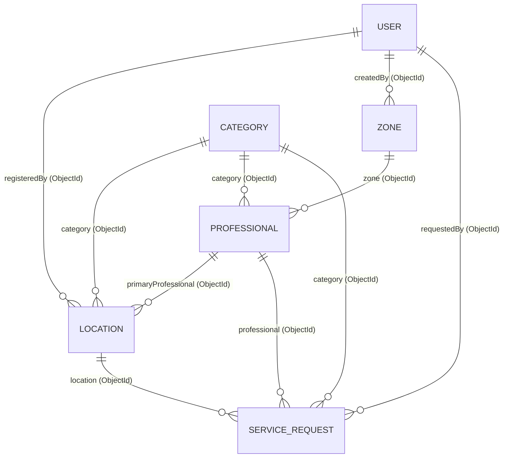

# Diseño de Base de Datos (MongoDB Atlas + Mongoose) — S.O.S. Geo

---

## 1. Principios de Modelado y Separación de Responsabilidades

1. **Separación entre `Location` y `Professional` (Sin duplicación):**
   - **`Location` (Punto Geográfico de Atención):** Representa un punto físico sobre el mapa (base de auxilio, módulo de asistencia, taller o caseta). Posee el campo `location` en formato **GeoJSON `Point` (`[longitud, latitud]`)** con índice `2dsphere`.
   - **`Professional` (Especialista / Técnico):** Representa a la persona o especialista calificado (nombre, especialidad, teléfono, correo, años de experiencia, categoría y zona). No duplica coordenadas `lat/lng`.
2. **Estándar GeoJSON Obligatorio:**
   - Todas las coordenadas en `Location.location.coordinates` y `Zone.area.coordinates` se almacenan estrictamente en orden **`[longitud, latitud]`** (`longitude` entre `-180` y `180`, `latitude` entre `-90` y `90`).
3. **Transformación JSON Uniforme:**
   - Todos los esquemas Mongoose incluyen `timestamps: true` y transforman `_id` en `id` eliminando `_id` y `__v` (y `password` en `User`).

---

## 2. Diagrama Entidad-Relación (Referencias `ObjectId`)



---

## 3. Especificación de las 6 Colecciones

### 3.1 `User` (Colección: `users`)
- **Propósito:** Almacenar los usuarios del sistema para inicio de sesión, registro y auditoría de creación de registros.
- **Campos y Validaciones:**
  - `name`: `String` (`required: true`, `trim: true`, `minLength: 3`, `maxLength: 80`)
  - `email`: `String` (`required: true`, `unique: true`, `lowercase: true`, `trim: true`, formato de correo válido)
  - `password`: `String` (`required: true`, `minLength: 8`, almacenado como hash `bcrypt`, excluido en `toJSON`)
  - `role`: `String` (`required: true`, `enum: ["admin", "operador"]`, `default: "operador"`)
- **Referencias `ObjectId`:** Ninguna.
- **Índices:** `{ email: 1 }` (`unique: true`).
- **Operaciones:** Registro (`POST /api/auth/register`), Login (`POST /api/auth/login`), Perfil (`GET /api/auth/me`).

---

### 3.2 `Category` (Colección: `categories`) — *CRUD Interno #1*
- **Propósito:** Clasificar los servicios de asistencia y definir su identidad visual (color e icono) en el mapa y tablas.
- **Campos y Validaciones:**
  - `name`: `String` (`required: true`, `unique: true`, `trim: true`, `minLength: 3`, `maxLength: 60`)
  - `description`: `String` (`required: true`, `trim: true`, `minLength: 10`, `maxLength: 200`)
  - `color`: `String` (`required: true`, regex `^#[0-9A-Fa-f]{6}$`, ej. `"#d92d20"`)
  - `icon`: `String` (`required: true`, `trim: true`, `maxLength: 30`, ej. `"car"`, `"home"`, `"cpu"`, `"shield"`)
  - `isActive`: `Boolean` (`default: true`)
- **Referencias `ObjectId`:** Ninguna.
- **Índices:** `{ name: 1 }` (`unique: true`).
- **Operaciones CRUD:** `GET`, `GET /:id`, `POST`, `PATCH /:id`, `DELETE /:id` en `/api/categories`.
- **Regla contra referencias huérfanas:** Antes de eliminar una categoría, `CategoriesService.delete(id)` verifica con `countDocuments({ category: id })` en `LocationModel`, `ProfessionalModel` y `ServiceRequestModel`. Si el conteo es mayor a 0, lanza `new AppError(400, "No se puede eliminar la categoría porque tiene registros asociados")`.

---

### 3.3 `Professional` (Colección: `professionals`) — *CRUD Interno #2*
- **Propósito:** Gestionar el directorio de técnicos, brigadistas y especialistas de asistencia.
- **Campos y Validaciones:**
  - `fullName`: `String` (`required: true`, `trim: true`, `minLength: 4`, `maxLength: 90`)
  - `specialty`: `String` (`required: true`, `trim: true`, `minLength: 4`, `maxLength: 100`)
  - `phone`: `String` (`required: true`, `trim: true`, regex `^[0-9+\-\s]{10,15}$`)
  - `email`: `String` (`required: true`, `unique: true`, `lowercase: true`, `trim: true`)
  - `experienceYears`: `Number` (`required: true`, `min: 0`, `max: 60`)
  - `status`: `String` (`required: true`, `enum: ["disponible", "en_servicio", "inactivo"]`, `default: "disponible"`)
  - `category`: `mongoose.Schema.Types.ObjectId` (`ref: "Category"`, `required: true`)
  - `zone`: `mongoose.Schema.Types.ObjectId` (`ref: "Zone"`, `default: null`)
- **Índices:** `{ email: 1 }` (`unique: true`), `{ category: 1 }`.
- **Operaciones CRUD:** `GET`, `GET /:id`, `POST`, `PATCH /:id`, `DELETE /:id` en `/api/professionals` (con `.populate("category", "name color icon")` y `.populate("zone", "name color")`).
- **Regla contra referencias huérfanas:**
  - Al crear o editar, se verifica que el `ObjectId` de `category` (y `zone` si se envía) exista en MongoDB.
  - Al eliminar un profesional, se desvincula automáticamente de `Location.primaryProfessional` y `ServiceRequest.professional` (`$set: { primaryProfessional: null }`).

---

### 3.4 `ServiceRequest` (Colección: `servicerequests`) — *CRUD Interno #3*
- **Propósito:** Registrar y dar seguimiento a solicitudes de asistencia ciudadana vinculadas a un punto geográfico, una categoría y un profesional.
- **Campos y Validaciones:**
  - `folio`: `String` (`required: true`, `unique: true`, generado automáticamente ej. `"SOS-2026-001"`)
  - `title`: `String` (`required: true`, `trim: true`, `minLength: 4`, `maxLength: 90`)
  - `description`: `String` (`required: true`, `trim: true`, `minLength: 10`, `maxLength: 300`)
  - `priority`: `String` (`required: true`, `enum: ["baja", "media", "alta", "critica"]`, `default: "media"`)
  - `status`: `String` (`required: true`, `enum: ["pendiente", "en_proceso", "atendida", "cancelada"]`, `default: "pendiente"`)
  - `contactName`: `String` (`required: true`, `trim: true`, `minLength: 3`, `maxLength: 80`)
  - `contactPhone`: `String` (`required: true`, `trim: true`, `minLength: 10`, `maxLength: 15`)
  - `category`: `mongoose.Schema.Types.ObjectId` (`ref: "Category"`, `required: true`)
  - `location`: `mongoose.Schema.Types.ObjectId` (`ref: "Location"`, `required: true`)
  - `professional`: `mongoose.Schema.Types.ObjectId` (`ref: "Professional"`, `default: null`)
  - `requestedBy`: `mongoose.Schema.Types.ObjectId` (`ref: "User"`, `required: true`)
- **Índices:** `{ status: 1, priority: 1 }`, `{ category: 1 }`, `{ location: 1 }`.
- **Operaciones CRUD:** `GET`, `GET /:id`, `POST`, `PATCH /:id`, `DELETE /:id` en `/api/service-requests` (con `.populate("category location professional requestedBy")`).
- **Regla contra referencias huérfanas:** Se valida la existencia previa en MongoDB de `category`, `location` y `professional` antes de crear o actualizar la solicitud.

---

### 3.5 `Location` (Colección: `locations`) — *GeoJSON Point*
- **Propósito:** Almacenar las ubicaciones exactas registradas por clic en el mapa, editables y eliminables desde su popup, filtrables en backend y sincronizadas con la tabla en tiempo real.
- **Campos y Validaciones:**
  - `name`: `String` (`required: true`, `trim: true`, `minLength: 4`, `maxLength: 80`)
  - `description`: `String` (`required: true`, `trim: true`, `minLength: 10`, `maxLength: 250`)
  - `category`: `mongoose.Schema.Types.ObjectId` (`ref: "Category"`, `required: true`)
  - `status`: `String` (`required: true`, `enum: ["activo", "en_servicio", "inactivo"]`, `default: "activo"`)
  - `contactPhone`: `String` (`trim: true`, `maxLength: 15`, `default: ""`)
  - `primaryProfessional`: `mongoose.Schema.Types.ObjectId` (`ref: "Professional"`, `default: null`)
  - `registeredBy`: `mongoose.Schema.Types.ObjectId` (`ref: "User"`, `required: true`)
  - `location`:
    - `type`: `{ type: String, enum: ["Point"], default: "Point", required: true }`
    - `coordinates`: `{ type: [Number], required: true }` — **`[longitud, latitud]`**
- **Índices:**
  - `locationSchema.index({ location: "2dsphere" })` (**Obligatorio por rúbrica**)
  - `locationSchema.index({ category: 1, status: 1 })`
- **Operaciones CRUD:** `GET` (con filtros `?search=&category=&status=`), `GET /geojson`, `GET /:id`, `POST`, `PATCH /:id`, `DELETE /:id` en `/api/locations`.
- **Regla contra referencias huérfanas:** Al eliminar una `Location` desde su popup en el mapa, se eliminan en cascada las solicitudes vinculadas a ese punto (`ServiceRequestModel.deleteMany({ location: id })`) para que la eliminación desde el popup siempre funcione sin bloqueos y sin dejar solicitudes huérfanas.

---

### 3.6 `Zone` (Colección: `zones`) — *GeoJSON Polygon*
- **Propósito:** Almacenar las zonas poligonales de cobertura trazadas por el usuario sobre el mapa.
- **Campos y Validaciones:**
  - `name`: `String` (`required: true`, `trim: true`, `minLength: 3`, `maxLength: 80`)
  - `description`: `String` (`trim: true`, `maxLength: 200`, `default: "Zona de cobertura operativa"`)
  - `color`: `String` (regex `^#[0-9A-Fa-f]{6}$`, `default: "#1570ef"`)
  - `createdBy`: `mongoose.Schema.Types.ObjectId` (`ref: "User"`, `required: true`)
  - `area`:
    - `type`: `{ type: String, enum: ["Polygon"], default: "Polygon", required: true }`
    - `coordinates`: `{ type: [[[Number]]], required: true }` — arreglo de anillos cerrados en orden **`[longitud, latitud]`**
- **Índices:**
  - `zoneSchema.index({ area: "2dsphere" })` (**Obligatorio por rúbrica**)
- **Operaciones CRUD:** `GET`, `GET /geojson`, `GET /:id`, `POST`, `DELETE /:id` en `/api/zones`.
- **Regla contra referencias huérfanas:** Al eliminar una `Zone`, se ejecuta `ProfessionalModel.updateMany({ zone: id }, { $set: { zone: null } })`.

---

## 4. Ejemplos Válidos de Documentos GeoJSON

### 4.1 Ejemplo de `Location` (`GeoJSON Point` en `[longitud, latitud]`)
```json
{
  "name": "Módulo S.O.S. Automotriz Campestre",
  "description": "Punto de auxilio mecánico, paso de corriente y grúa 24 horas.",
  "category": "673f1a2b3c4d5e6f7a8b9c01",
  "status": "activo",
  "contactPhone": "4771234567",
  "primaryProfessional": "673f2b3c4d5e6f7a8b9c0201",
  "registeredBy": "673f10000000000000000001",
  "location": {
    "type": "Point",
    "coordinates": [-101.6812, 21.1248]
  }
}
```

### 4.2 Ejemplo de `Zone` (`GeoJSON Polygon` cerrado en `[longitud, latitud]`)
> **Regla GeoJSON Polygon:** El anillo exterior debe tener al menos 4 posiciones (3 vértices distintos + el cierre) y la primera coordenada `[-101.6950, 21.1550]` debe ser exactamente igual a la última `[-101.6950, 21.1550]`.

```json
{
  "name": "Zona de Cobertura Norte - La Salle Campestre",
  "description": "Cobertura prioritaria de respuesta menor a 15 minutos",
  "color": "#1570ef",
  "createdBy": "673f10000000000000000001",
  "area": {
    "type": "Polygon",
    "coordinates": [
      [
        [-101.6950, 21.1550],
        [-101.6750, 21.1550],
        [-101.6750, 21.1400],
        [-101.6950, 21.1400],
        [-101.6950, 21.1550]
      ]
    ]
  }
}
```
