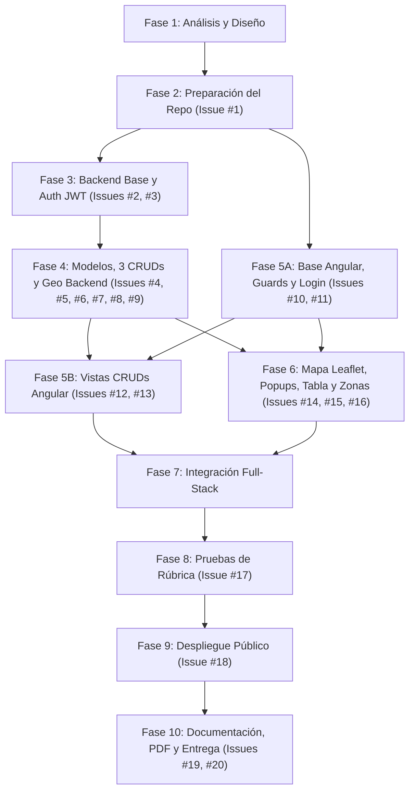

# Plan de Proyecto — S.O.S. Geo

**Materia:** Aplicación de Sistemas Georreferenciados  
**Institución:** Universidad La Salle Bajío  
**Docente:** MTWDM Jair Emmanuel Ramírez Flores  
**Equipo:** 3 Integrantes (Desarrollo Full-Stack)

---

## 1. Resumen Ejecutivo

**S.O.S. Geo** es una plataforma web georreferenciada de asistencia y servicios de soporte ciudadano (automotriz, servicios del hogar, soporte tecnológico y asistencia vial/médica básica), centrada operativamente en la ciudad de León, Guanajuato (`[21.122, -101.68]`).

La aplicación resuelve la problemática de localizar puntos físicos de atención verificados, identificar profesionales asignados por categoría, delimitar zonas geográficas de cobertura operativa y gestionar solicitudes de servicio ciudadano. La ubicación geográfica es el eje central de la solución:

- Los **puntos de atención (`Location`)** se registran haciendo clic directamente sobre el mapa, almacenándose como **GeoJSON `Point` (`[longitud, latitud]`)** con índice `2dsphere`, y se consultan, filtran, editan y eliminan directamente desde sus **popups interactivos** en sincronía en tiempo real con una tabla inferior sin recargar la página.
- Las **zonas de cobertura (`Zone`)** se trazan como polígonos sobre el mapa con **Leaflet-Geoman**, almacenándose como **GeoJSON `Polygon` (`[longitud, latitud]`)** con índice `2dsphere` y persistencia completa en MongoDB Atlas.
- El sistema integra autenticación **JWT + bcrypt** y **3 CRUDs internos completos** (`Category`, `Professional`, `ServiceRequest`) vinculados mediante referencias `ObjectId` y `.populate()`.

---

## 2. Alcance Funcional del MVP

### 2.1 Funcionalidades Incluidas (Obligatorias por Rúbrica)
1. **Autenticación y Registro (`User`):**
   - Vista propia de Login y Registro con validación de campos, bloqueo de correos duplicados, contraseñas cifradas con `bcrypt` y sesión con `JWT`.
   - Protección de vistas internas en Angular mediante `AuthGuard` y protección de endpoints con middleware `auth.handler.js`.
2. **3 CRUDs Internos Completos con Relaciones `ObjectId` + `populate()`:**
   - **Categorías (`Category`):** Crear, listar, editar y eliminar categorías de asistencia (*Asistencia Automotriz*, *Servicios del Hogar*, *Soporte Tecnológico*, *Asistencia Vial*).
   - **Profesionales (`Professional`):** Crear, listar, editar y eliminar especialistas vinculados por `ObjectId` a una `Category` y opcionalmente a una `Zone`.
   - **Solicitudes de Servicio (`ServiceRequest`):** Crear, listar, editar estado/prioridad y eliminar solicitudes vinculadas por `ObjectId` a `User` (solicitante), `Category`, `Professional` y `Location` (punto de atención).
3. **Georreferenciación de Ubicaciones Exactas (`Location` — GeoJSON `Point`):**
   - Registro haciendo clic en el mapa (`nombre`, `descripción`, `categoría`, `estado`, `profesional opcional`, `coordenadas [lng, lat]`).
   - Edición y eliminación **directamente desde el popup del marcador en el mapa**, persistiendo en MongoDB y actualizando mapa y tabla sin recargar la página.
   - Tabla en tiempo real con todos los datos de las ubicaciones excepto el ID, mostrando el nombre de la categoría (vía `populate`) y no su `ObjectId`.
4. **Búsqueda y 3 Filtros Combinados en Backend (`?search=&category=&status=`):**
   - Búsqueda parcial insensible a mayúsculas/minúsculas (`$regex`), filtro por categoría (`ObjectId`) y tercer filtro por estado operativo (`activo`, `en_servicio`, `inactivo`), reflejando resultados simultáneamente en el mapa y en la tabla.
5. **Trazo y Persistencia de Zonas (`Zone` — GeoJSON `Polygon`):**
   - Dibujo de polígonos sobre el mapa con asignación de nombre, guardado como GeoJSON `Polygon` en orden `[longitud, latitud]`, recarga automática al abrir la aplicación y eliminación por el usuario.

### 2.2 Funcionalidades Excluidas (Fuera del Alcance del MVP)
- Pasarelas de pago reales o simuladas.
- Chat en tiempo real con WebSockets / Socket.IO o notificaciones Web Push.
- Triage automatizado con Inteligencia Artificial.
- Seguimiento GPS continuo en tiempo real desde dispositivos móviles.

### 2.3 Alineación con la Rúbrica y Referencias Académicas
1. **Frontend Angular CLI obligatorio:** A diferencia del frontend vanilla del repositorio académico `SistemaAccidentes`, la rúbrica prohíbe HTML/JS suelto (*requisito eliminatorio*). Todo el frontend se desarrolla en **Angular CLI con TypeScript**.
2. **Arquitectura por capas sin `controllers/`:** A diferencia de `sos-app` (que usaba PostgreSQL, TypeScript y controladores), el backend respeta estrictamente las capas vistas en el semestre (`config`, `models`, `routes`, `services`, `middlewares`, `utils`, `data`) en **JavaScript CommonJS**, donde `routes` invoca directamente a `services`.
3. **Categoría como Colección Relacional (`ObjectId`):** `Category` es una colección independiente referenciada por `ObjectId` y poblada con `.populate()` para mostrar siempre su nombre en la tabla de ubicaciones y nunca su `ObjectId`.
4. **Edición y Eliminación Inline desde el Popup:** Los controles de edición y eliminación de una ubicación residen dentro del propio popup del marcador de Leaflet.

---

## 3. Requisitos Funcionales y No Funcionales

### 3.1 Requisitos Funcionales (RF)
- **RF-01 (Registro de Usuarios):** Permitir registrar nuevos usuarios validando nombre, correo único, contraseña (mínimo 8 caracteres) y rol, cifrando la contraseña con `bcrypt`.
- **RF-02 (Inicio de Sesión):** Autenticar usuarios contra MongoDB comparando el hash de `bcrypt`, emitiendo un token `JWT` y mostrando mensajes claros ante credenciales inválidas.
- **RF-03 (Protección de Vistas):** Bloquear en Angular el acceso a todas las vistas internas si no existe sesión activa (`AuthGuard`).
- **RF-04 (CRUD Categorías):** Crear, listar, actualizar y eliminar categorías de servicio (`Category`), validando integridad referencial antes de eliminar.
- **RF-05 (CRUD Profesionales):** Crear, listar (con `.populate('category')` y `.populate('zone')`), actualizar y eliminar profesionales (`Professional`).
- **RF-06 (CRUD Solicitudes de Servicio):** Crear, listar (con `.populate('category professional location requestedBy')`), actualizar y eliminar solicitudes (`ServiceRequest`).
- **RF-07 (Registro de Ubicación por Clic en Mapa):** Al hacer clic sobre el mapa Leaflet, capturar coordenadas `[longitud, latitud]`, solicitar nombre, descripción, categoría y estado, guardar como GeoJSON `Point` y renderizar el marcador con su popup.
- **RF-08 (Edición desde Popup):** Permitir editar nombre, descripción, categoría y estado de una ubicación directamente desde su popup en el mapa y persistir los cambios en MongoDB.
- **RF-09 (Eliminación desde Popup):** Permitir eliminar una ubicación directamente desde su popup en el mapa, borrándola en MongoDB y retirándola del mapa y la tabla.
- **RF-10 (Tabla Sincronizada en Tiempo Real):** Mostrar junto al mapa una tabla con todas las columnas de las ubicaciones registradas (excepto el `id`/`_id`), mostrando el nombre de la categoría poblada y actualizándose sin recargar la página tras cada alta, edición o baja.
- **RF-11 (Búsqueda y 3 Filtros en Backend):** Filtrar ubicaciones mediante query params `?search=&category=&status=` resueltos en MongoDB y actualizar tanto los marcadores del mapa como las filas de la tabla.
- **RF-12 (Trazo y Persistencia de Zonas):** Dibujar polígonos en el mapa con Leaflet-Geoman, asignarles nombre, guardarlos como GeoJSON `Polygon` `[longitud, latitud]`, cargarlos al iniciar y permitir eliminarlos.

### 3.2 Requisitos No Funcionales (RNF)
- **RNF-01 (Arquitectura Backend):** Node.js + Express en CommonJS (`"use strict";`) siguiendo exactamente las capas del semestre: `config`, `models`, `routes`, `services`, `middlewares`, `utils` y `data`.
- **RNF-02 (Estándar GeoJSON e Índices):** Todas las coordenadas se almacenan en orden `[longitud, latitud]` con índice `2dsphere` en `Location.location` y `Zone.area`.
- **RNF-03 (Manejo Centralizado de Errores y Códigos HTTP):** Uso de `AppError`, `notFoundHandler`, `logErrors` y `errorHandler` devolviendo códigos `200`, `201`, `400`, `401`, `404` y `500`.
- **RNF-04 (Seguridad y Entorno):** Ninguna credencial en código fuente; uso de `.env` y entrega de `.env.example` limpio; límite JSON de `100kb` y CORS configurado por `FRONTEND_ORIGINS`.
- **RNF-05 (Disponibilidad y Despliegue):** Frontend en Vercel/Netlify, Backend en Render/Railway y Base de Datos en MongoDB Atlas, accesibles públicamente durante todo el periodo de revisión.

---

## 4. Organización y División de Trabajo (Equipo de 3 Integrantes)

Para cumplir con las reglas de **"Trabajo en equipo"** y **"Dominio del código"** de la rúbrica, los 3 integrantes desarrollan funcionalidades completas (Backend + MongoDB + Frontend Angular + Pruebas + Documentación):

| Rol / Integrante | Responsabilidad en Backend y MongoDB | Responsabilidad en Frontend Angular | Integración, Pruebas y Documentación |
| :--- | :--- | :--- | :--- |
| **Integrante 1: Líder de Plataforma, Auth y Solicitudes** | Configuración base de Express (`app.js`, `index.js`, `database.js`, `AppError`, `error.handler.js`), modelos/servicios/rutas de `User` (Auth JWT + `bcrypt`) y `ServiceRequest` (CRUD #3 con 4 `.populate()`). | Configuración de Angular CLI, `AuthGuard`, `AuthInterceptor`, `NavbarComponent`, `AlertToastComponent`, **Vista 1 (Login/Registro)** y **Vista 4 (CRUD Solicitudes)**. | Despliegue en Render + Vercel, configuración de variables de entorno y sección de Arquitectura/Seguridad del Reporte PDF. |
| **Integrante 2: Especialista Geoespacial (Ubicaciones, Popups y Filtros)** | Modelo, validador, servicio y rutas de `Location` (GeoJSON `Point [lng, lat]`, índice `2dsphere`, filtros backend `?search=&category=&status=` y endpoint `/geojson`). | **Vista 2 (Mapa Leaflet + Barra de Filtros + Tabla sincronizada en tiempo real)**: registro por clic en mapa, **edición y eliminación dentro del popup del marcador**, sincronización sin recargar página. | Pruebas de filtros combinados, validación de coordenadas, redacción de `README.md` y capturas de requisitos geográficos para el Reporte PDF. |
| **Integrante 3: Especialista en Zonas (Polígonos) y Catálogos** | Modelos, validadores, servicios y rutas de `Zone` (GeoJSON `Polygon [lng, lat]`, validación de anillo cerrado e índice `2dsphere`), `Category` (CRUD #1) y `Professional` (CRUD #2) + script global `seed.js`. | Integración de **Leaflet-Geoman en Vista 2** (dibujo, guardado, recarga y eliminación de polígonos) y **Vista 3 (CRUDs de Categorías y Profesionales)**. | Ejecución de seeds con el usuario de prueba en MongoDB Atlas, pruebas de integridad referencial y sección de Modelos/Relaciones del Reporte PDF. |

---

## 5. Cronograma de 10 Fases y Ruta Crítica

| Fase | Nombre | Tareas / Issues | Dependencias | Bloqueos Potenciales | Entregable Verificable |
| :---: | :--- | :--- | :--- | :--- | :--- |
| **1** | Análisis y diseño | Definición de alcance, modelos y contratos JSON | Ninguna | Cambios de última hora en entidades | Documentos en `docs/*.md` aprobados |
| **2** | Preparación del repositorio | Issue #1 (`backend/`, `frontend/`, `.gitignore`, `.env.example`) | Fase 1 | Diferencias de versión de Node/Angular CLI en el equipo | Rama `dev` creada con esqueleto compilando |
| **3** | Backend base y autenticación | Issues #2, #3 (`app.js`, `AppError`, `User`, `bcrypt`, `JWT`) | Fase 2 | Cadena `MONGODB_URI` o IP no autorizada en Atlas | `/api/health`, `/api/auth/register` y `/api/auth/login` probados |
| **4** | Modelos y CRUDs Backend | Issues #4, #5, #6, #7, #8, #9 (`Category`, `Zone`, `Professional`, `Location`, `ServiceRequest`, `seed.js`) | Fase 3 | Orden invertido de coordenadas o anillos de polígonos abiertos | `npm run seed` ejecutado y endpoints REST probados con `.http` |
| **5** | Frontend Angular (Auth y CRUDs) | Issues #10, #11, #12, #13 (Vistas 1, 3 y 4) | Fases 2, 3 y 4 | Errores de CORS o expiración de token JWT | Login/Registro y los 3 CRUDs operando en navegador |
| **6** | Funcionalidades geográficas | Issues #14, #15, #16 (Mapa Leaflet, clic, edición/borrado en popup, tabla, filtros y polígonos Geoman) | Fase 4 y Issue #10 | Eventos DOM dentro de popups de Leaflet en Angular | Mapa creando/editando/eliminando puntos desde popup y guardando polígonos |
| **7** | Integración | Unión de todas las ramas `feature/*` en `dev` | Fases 5 y 6 | Conflictos de merge en `app.routes.ts` o `routes/index.js` | Flujo completo de punta a punta en entorno local |
| **8** | Pruebas | Issue #17 (Matriz de 12 pruebas obligatorias) | Fase 7 | Filtros que no actualicen mapa y tabla a la vez | Checklist de pruebas 100% en verde |
| **9** | Despliegue | Issue #18 (MongoDB Atlas + Render + Vercel) | Fase 8 | Cold start de Render o ruta de SPA fallback (`vercel.json`) en Angular | URL pública operativa con usuario de prueba precargado |
| **10** | Documentación y entrega | Issues #19, #20 (`README.md`, auditoría `.env`, Reporte PDF en Teams) | Fase 9 | Falta de capturas o conclusiones individuales | Liga publicada + Usuario demo + Repo público + PDF subidos a Teams |

- **Ruta Crítica:** `Issue #1 → Issue #2 → Issue #3 → Issue #4 → Issue #7 → Issue #14 → Issue #15 → Issue #16 → Issue #18 → Issue #20`.
