# División del Equipo y Orden de Ejecución por Etapas (Sprints) — S.O.S. Geo

**Repositorio:** `https://github.com/Neotechmo/S.O.S.-Geo`  
**Equipo de Desarrollo:**
- **`@Kuripipeer`** — Backend (Node.js, Express en capas, Servicios, Rutas, Validadores, Filtros y Auth JWT)
- **`@SergioErnestoRosasDucoing`** — Base de Datos (MongoDB Atlas, Esquemas Mongoose, `bcrypt`, Referencias `ObjectId`, Índices `2dsphere` y Seeds)
- **`@angx7`** — Frontend (Angular CLI, TypeScript, Guards/Interceptors, Vistas CRUD, Mapa Leaflet y Polígonos con Leaflet-Geoman)

---

## 1. Flujo de Trabajo Paralelo por Etapas (Sprints)

Los issues están numerados del **#1 al #20**, pero se trabajan **en paralelo en 3 carriles** (Base de Datos, Backend y Frontend) divididos en **5 Etapas (Sprints)** para que nadie tenga que esperar a que otro termine todo su módulo:

```mermaid
flowchart LR
    subgraph S1["Sprint 1: Arranque y Base"]
        I1["#1 Setup Repo (@Kuripipeer)"]
        I2["#2 Core Express + AppError (@Kuripipeer)"]
        I10["#10 Base Angular + Guards + Alertas (@angx7)"]
    end

    subgraph S2["Sprint 2: Auth y Modelos Base"]
        I3["#3 User + bcrypt + Auth JWT (@Sergio + @Kuri)"]
        I4["#4 Category CRUD (@Sergio + @Kuri)"]
        I5["#5 Zone Polygon 2dsphere (@Sergio + @Kuri)"]
        I11["#11 Vista 1: Login/Registro (@angx7)"]
    end

    subgraph S3["Sprint 3: Modelos Relacionales y Catálogos"]
        I6["#6 Professional CRUD + populate (@Sergio + @Kuri)"]
        I7["#7 Location Point 2dsphere + 3 Filtros (@Sergio + @Kuri)"]
        I8["#8 ServiceRequest CRUD (@Sergio + @Kuri)"]
        I9["#9 Seeds con Usuario Demo (@Sergio)"]
        I12["#12 Vista 3: Categorías y Profesionales (@angx7)"]
    end

    subgraph S4["Sprint 4: Vistas Geográficas y Solicitudes"]
        I13["#13 Vista 4: Solicitudes (@angx7)"]
        I14["#14 Mapa Leaflet + Clic + Popup Edit/Delete (@angx7)"]
        I15["#15 Tabla Tiempo Real + 3 Filtros (@angx7)"]
        I16["#16 Polígonos Leaflet-Geoman (@angx7)"]
    end

    subgraph S5["Sprint 5: Pruebas, Despliegue y Entrega"]
        I17["#17 Pruebas Integrales (Los 3)"]
        I18["#18 Despliegue Atlas + Render + Vercel (Los 3)"]
        I19["#19 README + Limpieza .env (@Kuri + @Sergio)"]
        I20["#20 Reporte PDF + Repaso (Los 3)"]
    end

    S1 --> S2 --> S3 --> S4 --> S5
```

---

## 2. Tabla de Asignación y Orden de Ejecución (Sprints 1 a 5)

| Etapa / Sprint | Issue | Título | Asignado(s) en GitHub | Responsabilidad específica de cada integrante |
| :---: | :---: | :--- | :--- | :--- |
| **Sprint 1** | **#1** | `[DEVOPS]` Inicialización del monorepositorio y `.env.example` | `@Kuripipeer` | Crear carpetas base (`backend/`, `frontend/`), `.gitignore` y variables de entorno en `.env.example`. |
| **Sprint 1** | **#2** | `[BACKEND]` Express en capas, Mongoose y `AppError` | `@Kuripipeer` | Implementar `app.js`, `index.js`, `database.js`, `AppError` y `error.handler.js`. |
| **Sprint 1** | **#10** | `[FRONTEND]` Base Angular, Router, `AuthGuard`, Interceptor y Alertas | `@angx7` | En paralelo con #1 y #2: esqueleto Angular, rutas protegidas con `AuthGuard` y sistema de alertas. |
| **Sprint 2** | **#3** | `[DATABASE]` Modelo `User`, `bcrypt` y endpoints Auth JWT | `@SergioErnestoRosasDucoing`, `@Kuripipeer` | **Sergio:** `user.model.js` + cifrado `bcrypt`. **Kuri:** `auth.service.js`, `auth.router.js`, `auth.handler.js` (JWT). |
| **Sprint 2** | **#4** | `[BACKEND]` CRUD #1: `Category` y protección anti-huérfanos | `@SergioErnestoRosasDucoing`, `@Kuripipeer` | **Sergio:** `category.model.js`. **Kuri:** validador, servicio (bloqueo si está en uso) y router `/api/categories`. |
| **Sprint 2** | **#5** | `[GEO]` `Zone` con GeoJSON `Polygon` e índice `2dsphere` | `@SergioErnestoRosasDucoing`, `@Kuripipeer` | **Sergio:** `zone.model.js` (`Polygon [lng, lat]` + `2dsphere`). **Kuri:** servicio, validador de cierre de anillo y router `/api/zones`. |
| **Sprint 2** | **#11** | `[FRONTEND]` Vista 1: Login y Registro de Usuarios | `@angx7` | En paralelo con el Sprint 2: formularios reactivos de inicio de sesión y registro conectados a `/api/auth`. |
| **Sprint 3** | **#6** | `[BACKEND]` CRUD #2: `Professional` con `ObjectId` a Category y Zone | `@SergioErnestoRosasDucoing`, `@Kuripipeer` | **Sergio:** `professional.model.js` con referencias `ObjectId`. **Kuri:** `.populate('category zone')`, validador y router. |
| **Sprint 3** | **#7** | `[GEO]` `Location` con GeoJSON `Point`, `2dsphere` y 3 filtros Backend | `@SergioErnestoRosasDucoing`, `@Kuripipeer` | **Sergio:** `location.model.js` (`Point [lng, lat]` + `2dsphere`). **Kuri:** servicio con 3 filtros `?search=&category=&status=` y router. |
| **Sprint 3** | **#8** | `[BACKEND]` CRUD #3: `ServiceRequest` con múltiples `ObjectId` | `@SergioErnestoRosasDucoing`, `@Kuripipeer` | **Sergio:** `service-request.model.js` (4 referencias `ObjectId`). **Kuri:** `.populate()` completo, validador y router. |
| **Sprint 3** | **#9** | `[DATABASE]` Script `seed.js` con Usuario de Prueba en León, Gto. | `@SergioErnestoRosasDucoing` | Crear `seed.js` y `*.seed.js` con el usuario evaluador y datos georreferenciados iniciales en MongoDB Atlas. |
| **Sprint 3** | **#12** | `[FRONTEND]` Vista 3: CRUDs de Categorías y Profesionales | `@angx7` | En paralelo con el Sprint 3: pantallas de administración de categorías y profesionales. |
| **Sprint 4** | **#13** | `[FRONTEND]` Vista 4: CRUD de Solicitudes de Servicio | `@angx7` | Tabla y formulario de solicitudes mostrando categoría, punto de atención, profesional y usuario poblados. |
| **Sprint 4** | **#14** | `[GEO]` Vista 2: Mapa Leaflet, clic y Edición/Eliminación en Popup | `@angx7` | Registrar punto al hacer clic en el mapa y permitir editar y eliminar **directamente dentro del popup**. |
| **Sprint 4** | **#15** | `[FRONTEND]` Vista 2: Tabla en tiempo real sin ID + 3 Filtros Backend | `@angx7` | Tabla sincronizada sin recargar la página (mostrando nombre de categoría, sin ID) + barra de búsqueda y filtros. |
| **Sprint 4** | **#16** | `[GEO]` Vista 2: Trazo y persistencia de polígonos con Leaflet-Geoman | `@angx7` | Dibujar zonas en el mapa, nombrarlas, guardarlas como `GeoJSON Polygon`, recargarlas al abrir y eliminarlas. |
| **Sprint 5** | **#17** | `[BACKEND]` Pruebas de integración HTTP y verificación de rúbrica | `@Kuripipeer`, `@SergioErnestoRosasDucoing`, `@angx7` | **Kuri:** archivos `.http`. **Sergio:** índices `2dsphere` e integridad en Atlas. **Angel:** pruebas E2E en navegador. |
| **Sprint 5** | **#18** | `[DEVOPS]` Despliegue en MongoDB Atlas, Render y Vercel | `@Kuripipeer`, `@SergioErnestoRosasDucoing`, `@angx7` | **Sergio:** MongoDB Atlas. **Kuri:** Backend en Render/Railway. **Angel:** Frontend en Vercel/Netlify. |
| **Sprint 5** | **#19** | `[DOCS]` Limpieza de seguridad y `README.md` definitivo | `@Kuripipeer`, `@SergioErnestoRosasDucoing` | Verificar que no existan credenciales reales en Git y documentar la guía de ejecución local y usuario demo. |
| **Sprint 5** | **#20** | `[DOCS]` Reporte PDF institucional y repaso de dominio del código | `@Kuripipeer`, `@SergioErnestoRosasDucoing`, `@angx7` | Elaborar el PDF con capturas, desarrollo paso a paso, **3 conclusiones individuales** y repaso general del código. |

---

## 3. Resumen de Entregables por Integrante

### `@SergioErnestoRosasDucoing` (Base de Datos — MongoDB Atlas & Mongoose)
1. Cluster en MongoDB Atlas configurado y accesible.
2. Esquemas en `backend/src/models/`:
   - `user.model.js` (con hash `bcrypt` y transformación `toJSON` sin password).
   - `category.model.js`.
   - `zone.model.js` (`GeoJSON Polygon` `[longitud, latitud]` + índice `2dsphere`).
   - `professional.model.js` (referencias `ObjectId` a `Category` y `Zone`).
   - `location.model.js` (`GeoJSON Point` `[longitud, latitud]` + índice `2dsphere` + referencias `ObjectId`).
   - `service-request.model.js` (referencias `ObjectId` a `Category`, `Location`, `Professional` y `User`).
3. Seeds en `backend/src/data/` (`seed.js` y `*.seed.js`) con el **Usuario de Prueba** y datos en León, Gto.

### `@Kuripipeer` (Backend — Node.js & Express en Capas)
1. Configuración y núcleo en `backend/src/`: `index.js`, `app.js`, `config/database.js`, `utils/appError.js`, `utils/jwt.js` y `middlewares/error.handler.js`.
2. Middlewares de validación y seguridad en `backend/src/middlewares/`: `auth.handler.js` y los 6 archivos `*.validator.js`.
3. Servicios en `backend/src/services/`: `auth.service.js`, `categories.service.js`, `zones.service.js`, `professionals.service.js`, `locations.service.js` (con los 3 filtros `?search=&category=&status=`) y `service-requests.service.js`.
4. Rutas en `backend/src/routes/` y pruebas en `backend/request/*.http`.

### `@angx7` (Frontend — Angular CLI, Leaflet & Leaflet-Geoman)
1. Core de Angular (`app.routes.ts`, `auth.guard.ts`, `auth.interceptor.ts`, servicios `HttpClient`, `Navbar` y `AlertToast`).
2. **Vista 1 (`/auth`):** Login y Registro con validación y mensajes claros de error/éxito.
3. **Vista 2 (`/map`):** Mapa Leaflet interactivo (registro por clic, **edición y eliminación dentro del popup**, trazo y persistencia de polígonos con Leaflet-Geoman, barra de 3 filtros conectada al backend y tabla en tiempo real sin columna ID mostrando el nombre de la categoría).
4. **Vista 3 (`/directory`) y Vista 4 (`/requests`):** Los 3 CRUDs completos de Categorías, Profesionales y Solicitudes de Servicio.
